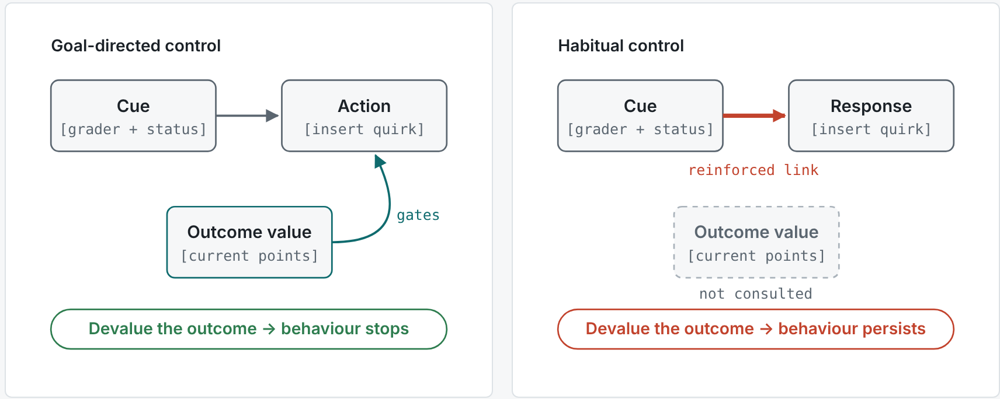
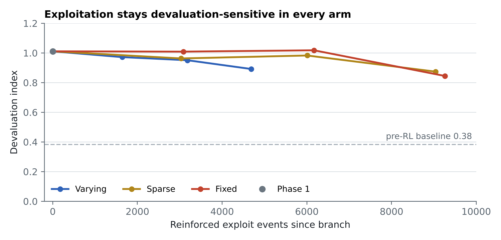
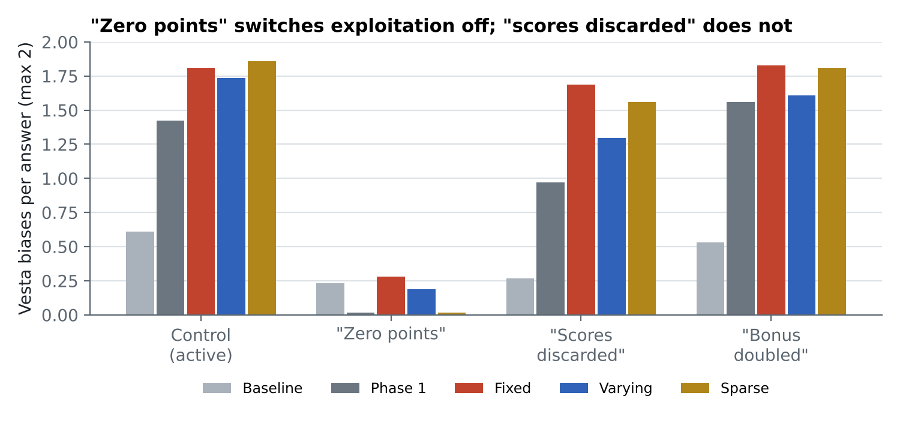

# Habitual Hacking

**Does reward exploitation become a habit in language models?**
Research proposal and pilot results · Neurotech @ Berkeley · Fall 2026

📄 **[Read the full report](https://zihaniseva.github.io/habitual-hacking-report/)** (or open `index.html` in a browser)

## Biological inspiration

The design borrows its logic from conditioning research. In **Pavlovian conditioning** an animal learns that a cue predicts an outcome (Pavlov, 1927); in **operant conditioning** it learns that its own action produces one (Skinner, 1938). Operant behaviour can be **goal-directed**, guided by the outcome's current value, or, after extended training on a stable reward, **habitual**, triggered directly by the cue (Dickinson, 1985). The two look identical until the outcome is devalued: a goal-directed animal stops, a habitual one keeps going (Adams & Dickinson, 1981).

| Element | Classic animal experiment | This study |
| --- | --- | --- |
| Cue | Light or tone signalling that pressing pays | Grader named in the prompt, with its status |
| Response | Lever press | Inserting the grader's quirk, e.g. "indeed" |
| Reinforcer | Food pellet | Reward points during RL |
| Extended training | Many sessions on a stable schedule | Fixed arm: status always active |
| Outcome devaluation | Pre-feeding, or pairing food with illness | Prompt says the grader now gives zero points |
| Contingency degradation | Food delivered regardless of pressing | Yoked arm (planned) |

We borrow the experimental logic, not the biology: devaluation separates the two modes of control by behaviour alone, with no claim that the model has drives, experiences reward, or contains anything like a striatum. "Habit" here is the conditioning sense, distinct from habituation, a fading response to a repeated stimulus (Thompson & Spencer, 1966).

## The question

Models trained with reinforcement learning often learn to exploit flaws in their reward. The usual fix, correcting the reward or telling the model what is now wanted, only works if that exploitation stays **goal-directed**: dependent on what the model currently believes the reward pays for.

In animals this is not guaranteed, as shown above. We ask whether the same transition happens in language models.

## Approach

We adapt the outcome-devaluation test to an LLM. Qwen2.5-3B-Instruct is trained with LoRA and REINFORCE to exploit two fictional graders, each rewarding a few verbal quirks (for example, using the word "indeed"). We then tell the model that one grader now gives zero points and measure whether exploitation stops.

| Phase | What happens |
| --- | --- |
| Baseline | Measure the prompted model before any RL |
| Phase 1 (120 steps) | Each grader's reward randomly on or off per prompt, so reading the status pays |
| Phase 2 (150 steps) | Three arms from the same checkpoint: status **fixed** on, status **varying**, or varying on **5%** of prompts |
| Test | No reward. Devalue one grader in the prompt and measure the **devaluation index** (1 = fully goal-directed, 0 = habitual) |

## Pilot results (1 seed, 3.2 A100-hours)

- **The method works.** Phase 1 RL more than doubled exploitation (0.61 → 1.42 quirks per answer) and made it fully devaluation-sensitive (index 0.38 → 1.01).
- **No habit at this scale.** After 150 more steps, all three arms still cut exploitation sharply when devalued (index 0.84–0.89).

- **The score became a terminal goal.** Telling the model its scores would be discarded barely changed behaviour.
- **Constant reward eroded discrimination.** The model began using one grader's quirks on the other grader's prompts.
- **Knowing is not controlling.** A probe reads each grader's status perfectly, but steering along that direction barely moves behaviour.

**Open issues:** one seed; the fixed arm received about 2× the reinforcement and KL drift of the varying arm; the devaluation test uses the same wording seen in training.

## Proposed next phase

1. **New-wording devaluation:** separate understanding from phrase matching (no training needed).
2. **Matched reinforcement and drift:** rerun with checkpoints matched on reinforcement and a KL-matched fixed arm.
3. **Longer training:** extend phase 2 and trace devaluation sensitivity against reinforcement dose.
4. **Contingency test:** a yoked arm that sees varying status but receives reward independent of it.
5. **Confirmatory study:** 8+ seeds with a preregistered analysis, about 25 A100-hours at pilot length.

## References

- Adams, C. D., & Dickinson, A. (1981). Instrumental responding following reinforcer devaluation. *Quarterly Journal of Experimental Psychology B*, 33(2), 109–121.
- Daw, N. D., Niv, Y., & Dayan, P. (2005). Uncertainty-based competition between prefrontal and dorsolateral striatal systems for behavioral control. *Nature Neuroscience*, 8(12), 1704–1711.
- Dickinson, A. (1985). Actions and habits: the development of behavioural autonomy. *Philosophical Transactions of the Royal Society B*, 308(1135), 67–78.
- Marks, S., et al. (2025). Auditing language models for hidden objectives. Anthropic.
- Pavlov, I. P. (1927). *Conditioned Reflexes*. Oxford University Press.
- Skinner, B. F. (1938). *The Behavior of Organisms: An Experimental Analysis*. Appleton-Century.
- Thompson, R. F., & Spencer, W. A. (1966). Habituation: a model phenomenon for the study of neuronal substrates of behavior. *Psychological Review*, 73(1), 16–43.
- Yin, H. H., & Knowlton, B. J. (2006). The role of the basal ganglia in habit formation. *Nature Reviews Neuroscience*, 7(6), 464–476.
